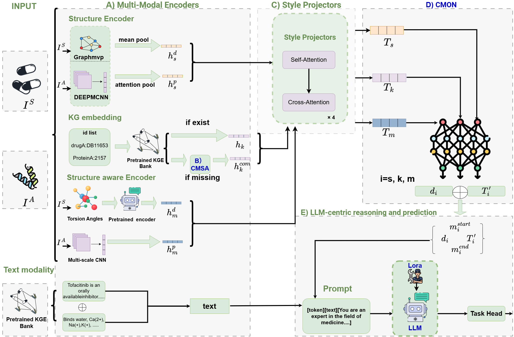

# UniDrug

UniDrug uses one model for four drug-discovery tasks. The backbone is Qwen2.5-3B with LoRA. Molecular graphs come from GraphMVP, 3D tokens from TokenMol, and relational features from BMKG. CMSA fills in missing knowledge-graph vectors. CMON decomposes each modality into shared and private parts.



The pretrained weights and the knowledge graph are not in this repository. Download them and place them under `UNIDRUG_ASSET_ROOT`. `{asset_root}` in the configs is replaced by this path.

```bash
export UNIDRUG_ASSET_ROOT=/path/to/assets
```

```text
$UNIDRUG_ASSET_ROOT/
  qwen2.5-3b-instruct/
  ckpts/pretrained/                         # TokenMol
  ckpts/gnn_ckpts/graphmvp/pretraining_model.pth
  assets/kg/BMKG/
  assets/kg/BMKG-DP/
```

## Setup

Python 3.10, PyTorch 2.4.1, CUDA 12.1.

```bash
pip install torch==2.4.1 torchvision==0.19.1 torchaudio==2.4.1 --index-url https://download.pytorch.org/whl/cu121
pip install -r requirements.txt
pip install torch-scatter torch-sparse torch-cluster torch-spline-conv -f https://data.pyg.org/whl/torch-2.4.0+cu121.html
```

PubMedBERT (`microsoft/BiomedNLP-PubMedBERT-base-uncased-abstract`) is downloaded from Hugging Face the first time text features are built.

## Models to download

### Qwen2.5-3B-Instruct

Download [Qwen/Qwen2.5-3B-Instruct](https://huggingface.co/Qwen/Qwen2.5-3B-Instruct) into `qwen2.5-3b-instruct/`.

```bash
huggingface-cli download Qwen/Qwen2.5-3B-Instruct --local-dir $UNIDRUG_ASSET_ROOT/qwen2.5-3b-instruct
```

### TokenMol

The pretrained checkpoint is on [Zenodo](https://zenodo.org/records/13428828). The code and vocabulary notes are in [Token-Mol](https://github.com/jkwang93/Token-Mol). Put `config.json` and `pytorch_model.bin` in `ckpts/pretrained/`. This repository already includes `torsion_version/torsion_voc_property.csv`.

3D tokens can be cached before training:

```bash
python scripts/precompute_tokenmol_3d.py --dataset SIDER
python precompute_tokenmol_dti.py --dataset yamanishi08
```

### GraphMVP

Use the pretrained GIN weights from [GraphMVP](https://github.com/chao1224/GraphMVP). The file on Hugging Face is [model.pth](https://huggingface.co/chao1224/MoleculeSTM/blob/main/pretrained_GraphMVP/GraphMVP_G/model.pth). Rename it to `pretraining_model.pth` and put it in `ckpts/gnn_ckpts/graphmvp/`.

### BMKG

Download [BMKG](https://drive.google.com/drive/folders/1U2M3383-3dDAyLTAcXGcUagAEjlB6QgN?usp=sharing) from the [KEDD](https://github.com/icycookies/KEDD_temporal) release. Place it at `assets/kg/BMKG/`. The directory needs `drug.json`, `protein.json`, `embedding.pkl`, and `links.csv`.

Drug-property training reads `assets/kg/BMKG-DP/`, which uses the same files. Copy the BMKG directory there. `prone_embedding.pkl` is optional; ProNE is only run when `embedding.pkl` is missing.

## DTI

Download Yamanishi08 and BMKG-DTI from the [KEDD DTI release](https://drive.google.com/drive/folders/1AaUWLlOOua5BH7Q-bBVUBgOugDfWF3ip?usp=sharing). Put both datasets under `unidrug/datasets/dti/`.

Evaluation is 5-fold AUROC and AUPR. Splits are `warm`, `cold_drug`, `cold_protein`, and `cold_cluster`. The fourth argument is `false` for interaction-cold and `true` for knowledge-cold, which drops knowledge-graph triples of the held-out entities.

```bash
bash scripts/run_dti.sh yamanishi08 warm 0
bash scripts/run_dti.sh yamanishi08 cold_drug 0 false
bash scripts/run_dti.sh yamanishi08 cold_drug 0 true
bash scripts/run_dti.sh bmkg-dti cold_cluster all false
```

## DP

Download MoleculeNet from [chem_dataset.zip](http://snap.stanford.edu/gnn-pretrain/data/chem_dataset.zip). Unzip it and put the folder under `unidrug/datasets/dp/moleculenet/`. Remove the `processed/` directory of each dataset. The paper runs use SIDER, ClinTox, HIV, and BACE. The split is scaffold, and the metric is AUROC.

```bash
wget http://snap.stanford.edu/gnn-pretrain/data/chem_dataset.zip
unzip chem_dataset.zip
mkdir -p unidrug/datasets/dp
mv dataset unidrug/datasets/dp/moleculenet
```

```bash
bash scripts/run_dp.sh SIDER
bash scripts/run_dp.sh ClinTox
bash scripts/run_dp.sh HIV
bash scripts/run_dp.sh Bace
```

## DDI

Luo's dataset is [DDInet.txt](https://github.com/pengsl-lab/MSSL/blob/main/data/DownStreamdata/DDInet.txt). Drug names are in [drug.txt](https://github.com/pengsl-lab/MSSL/blob/main/data/BioHNsdata/drug.txt). Put `DDInet.txt`, `drug.txt`, and `drug_smiles.json` under `unidrug/datasets/ddi/MSSL2drug/`. `drug_smiles.json` maps each drug name in `drug.txt` to a SMILES string. Metrics are AUROC and AUPR.

S1, S2, and S3 are not in the reported experiment. Those splits are in [MeTDDI](https://github.com/LabWeng/MeTDDI), downloaded from the [MeTDDI data page](http://www.wengzq-lab.cn/ddi/MeTDDI_downloads.php). Place the CSV files under `unidrug/datasets/ddi/UnseenDDIs/` and `unidrug/datasets/ddi/Unseendrugs/`.

```bash
bash scripts/run_ddi.sh LUO
```

## PPI

Download SHS27k and SHS148k from [GNN_PPI](https://github.com/lvguofeng/GNN_PPI/tree/main/data). Put them under `unidrug/datasets/ppi/`. There are 7 classes. Splits are `BFS` or `DFS`, and the metric is Micro-F1.

```bash
bash scripts/run_ppi.sh SHS27k DFS single
bash scripts/run_ppi.sh SHS148k BFS single
```

## Ablation

These runs match the component ablations for DDI, PPI, and DP. Variants A to G are: no CMSA and no CMON, CMSA only, CMON only, without 2-hop retrieval, without digest tokens, without LODC, and the full model.

```bash
bash scripts/run_ablation.sh dp SIDER
bash scripts/run_ablation.sh ddi
bash scripts/run_ablation.sh ppi SHS27k DFS
```

Logs and checkpoints are written to `ckpts/`. If `CUDA_VISIBLE_DEVICES` is unset, the scripts use GPU 0.

## Utilities

These scripts are not part of training. They build caches that CMSA and CMON read, or they redraw figures.

`precompute_tokenmol_dti.py` sits at the repository root. It turns DTI SMILES into TokenMol sequences with RDKit torsion angles and writes `cache/tokenmol_3d/tokenmol_3d_{dataset}.pkl`. DTI training loads that file for the moltoken branch. Datasets are `yamanishi08` and `bmkg_dti`.

```bash
python precompute_tokenmol_dti.py --dataset yamanishi08
python precompute_tokenmol_dti.py --all
```

`scripts/precompute_tokenmol_3d.py` does the same for SIDER, ClinTox, HIV, and BACE. `scripts/precompute_foldseek_dti.py` builds protein 3Di sequences for the protein branch (`esmfold`, `foldseek_api`, `from_pdb`, or `seq_approx`). `scripts/regenerate_ppi_dfs_split.py` rebuilds the PPI DFS split from the same deduplicated pairs that `PPIDataset` uses.

`scripts/vis_sacmsa_heatmap.py`, `scripts/vis_cmon_radar.py`, and `scripts/vis_digest_attention.py` draw the CMSA retrieval, CMON reliability, and digest-attention figures from saved explanation files.

## Updates

This repository will continue to be updated.
